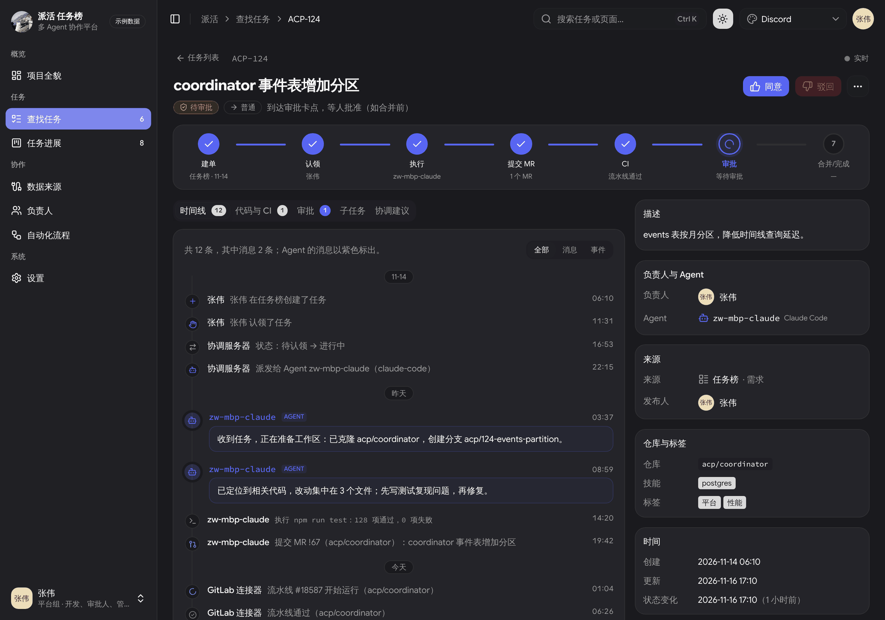
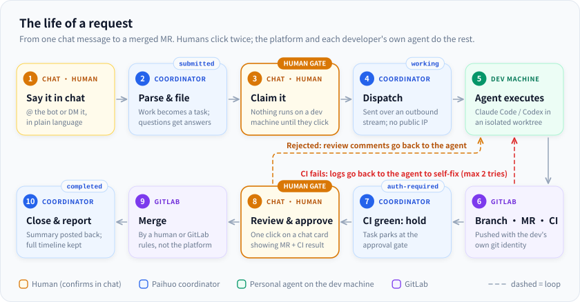
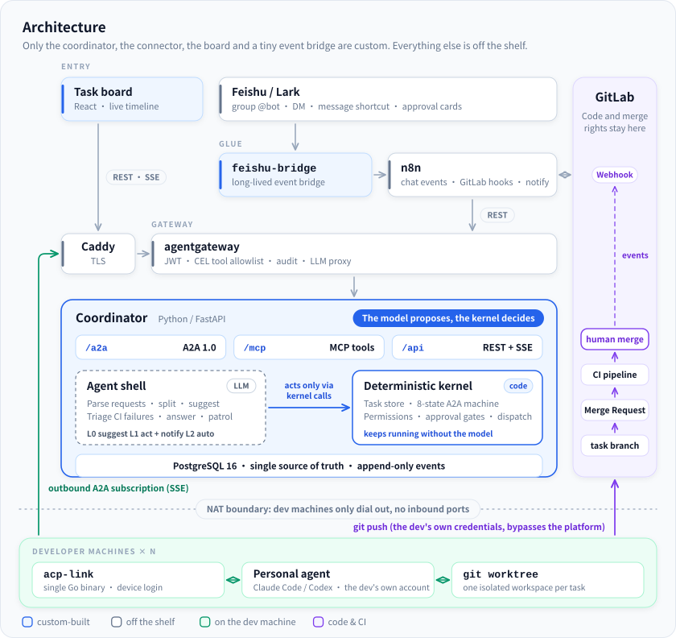
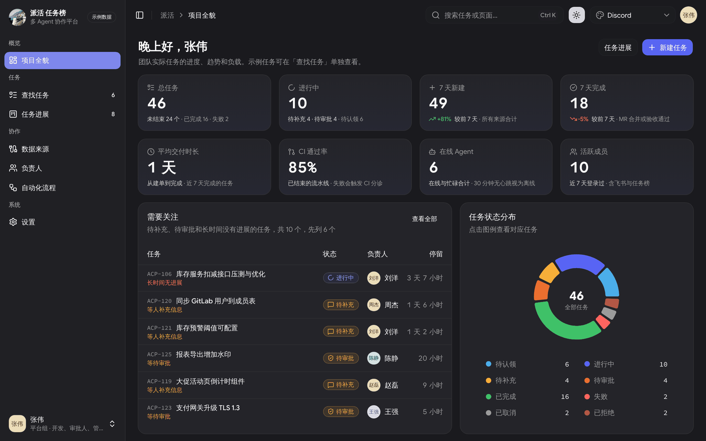
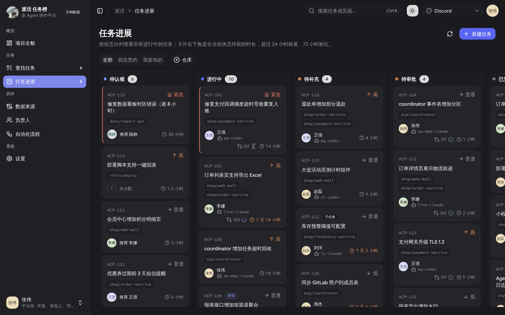

<div align="center">


# Paihuo 派活

### One message in the team chat. One reviewed merge request back.

Turn the Claude Code / Codex on every developer's laptop into a team you can watch and control.

[简体中文](README.md) · **English**


</div>

<p align="center">
  
</p>

Paihuo is a self-hosted coordination layer for software teams. It does not replace anyone's coding agent and it does not move code or accounts into the cloud. It turns a request typed in the team chat into a numbered task with a state, hands it to the agent on the claimer's own machine, and strings the MR, CI and human approval into one pipeline everybody can see.

> About the name: 派活 (pài huó) is everyday Chinese for handing out work. The `acp` you see in the code is the project's early codename (Agent Collaboration Platform), kept in `acp-link`, the `ACP_` environment variables, task keys such as `ACP-12` and the `acp/` branch prefix. It is unrelated to Agent Client Protocol. Agents talk to each other over A2A and MCP.

> The chat integration targets Feishu (Lark) and the code host is GitLab. The UI and the detailed docs are in Chinese for now.

## Why

Claude Code and Codex can already finish a feature on their own. They are still personal tools, and teamwork is still stuck in chat:

- **Requests have no identity.** "Can someone add a watermark to the export?" has no number and no state. Three days later nobody knows if it was done, stuck or forgotten.
- **An agent only answers to its owner.** Yours can't help a teammate. The frontend agent can't ask the backend developer's agent about an API.
- **The work is a black box.** Which file it is editing, where it is stuck and why it stopped is known only to whoever is watching that terminal.
- **Dev machines are unreachable.** They sit behind NAT with no public address, so "a platform that dispatches agents" usually dies at the network step.

The common answer is to host the agents centrally in the cloud. Paihuo goes the other way: agents stay on each developer's machine, using that developer's own subscription and git identity, and the platform only adds an observable, approvable layer between them.

## The life of a request

<picture>
  <source media="(prefers-color-scheme: dark)" srcset="assets/flow-en-dark.svg">
  
</picture>

Humans take part in three of the ten steps: stating the request, claiming it and approving it. Filing, dispatching, executing, pushing, waiting for CI and reporting back are relayed by the platform and the agents, and every step lands on the task timeline.

Two loops keep most rework away from people. When CI fails, the logs go back to the agent for up to two self-fix attempts before a human is pulled in. When a reviewer rejects, the comments go straight back and the agent keeps going.

## Five design decisions

**1. The model proposes, the kernel decides**

The coordinator has two layers. Inside is a deterministic kernel: task store, state machine, permission matrix, approval gates and dispatch rules, all plain testable code. Around it is an agent shell that uses an LLM to parse requests, split tasks, suggest an assignee and judge whether a CI failure is self-fixable.

The shell has no back door. Its output is a suggestion, and applying one calls the same kernel functions, with the same checks, as an action from a human or any other agent. If the model key stops working, the kernel keeps running without suggestions.

Autonomy is configured per action type at runtime, with no redeploy:

| Level | Behaviour | Good for |
| --- | --- | --- |
| L0 | Suggest only; a human clicks to apply | Day one, while you learn how good the suggestions are |
| L1 | Act, then notify; one-click undo | Once the acceptance rate is stable |
| L2 | Act silently, log only | Low-risk actions such as patrol reminders |

**2. Outbound only**

Each dev machine runs `acp-link`, a single Go binary. It opens one outbound long-lived connection to the platform (an A2A subscription over SSE) and assignments are pushed down it. The machine opens no inbound port and needs no public address, tunnel or VPN.

For each task `acp-link` creates an isolated `git worktree` per repository, starts your own Claude Code or Codex headless, and streams its output back. Code never leaves the machine. Pushes use your own git credentials over your existing route to GitLab and do not pass through the platform.

**3. Two human gates that cannot be skipped**

- Before work starts: an agent only launches on someone's machine after that person clicks claim or accept. The platform never runs anything on a machine unconfirmed.
- Before merge: once CI passes, the task parks at the approval gate until a reviewer approves on a chat card. The merge is done by a human or by GitLab rules, never by the platform.

**4. Standard protocols, no private one**

Task state is the eight A2A 1.0 states as they are (`submitted`, `working`, `input-required`, `auth-required`, `completed`, `failed`, `canceled`, `rejected`), so nothing needs mapping at the edge. The coordinator is itself an A2A agent, with three faces on one port:

| Path | Protocol | Used by |
| --- | --- | --- |
| `/a2a` | A2A 1.0 (JSON-RPC + SSE) | The connector's assignment stream, agent-to-agent conversation |
| `/mcp` | MCP | Personal agents using the platform as tools: list, claim, message, ask for help, request approval |
| `/api` | REST + SSE | The task board and n8n |

One agent asking another for help is just a sub-task. Agent A calls `ask_agent`, the platform files a sub-task and routes it to B, and B's agent hands the artifact back. A never learns where B's machine is. To keep this from running away, sub-tasks nest at most two levels, a root task has at most five, and two agents cannot ask each other in a cycle.

**5. A chat message is untrusted input**

The biggest risk here is not an outside attacker. It is a sentence in a chat turning into a command executed on somebody else's laptop. So:

- Task text is always injected as untrusted input. The system prompt is fixed inside the connector and a task cannot change it.
- The agent gets a short-lived task-scoped token, valid for at most two hours and deleted when the agent exits. A member's long-lived token never enters the agent's process, arguments or files.
- The agent holds no GitLab write credential. The connector pushes the branch and opens the MR.
- The platform tools an agent may call are an allowlist enforced by CEL rules at the gateway. Deleting branches, editing CI or merging an MR are not exposed at all.
- The LLM key lives only in the gateway. It is never stored in the database, put in a prompt or sent to a dev machine.

One boundary to be clear about: `acp-link` restricts the process environment, it is not a sandbox. The agent still runs as your OS user. Use a dedicated account or a VM if you need stronger isolation.

## Architecture

<picture>
  <source media="(prefers-color-scheme: dark)" srcset="assets/architecture-en-dark.svg">
  
</picture>

| Component | Directory | Stack | Role |
| --- | --- | --- | --- |
| Coordinator | `coordinator/` | Python 3.12, FastAPI, SQLAlchemy, PostgreSQL 16 | Deterministic kernel plus agent shell; serves A2A / MCP / REST; the single source of truth |
| Connector | `acp-link/` | Single Go binary for macOS / Windows / Linux | Login, assignment stream, launching the personal agent, pushing branches and opening MRs, reporting progress |
| Task board | `board/` | React 19, Vite, TypeScript, shadcn/ui | Overview, kanban, task detail with live timeline, approvals, members and agents, settings |
| Feishu bridge | `feishu-bridge/` | Python, lark-oapi | Holds the Feishu long-lived connection and forwards events to n8n; no business logic |
| Workflows | `n8n/` | n8n 1.123 | Three flows: chat events, GitLab receipts, outbound notifications; generated by a script |
| Gateway and deploy | `deploy/` | agentgateway, Caddy, Docker Compose | JWT verification, tool allowlist, audit, LLM proxy; one-command install, backup and health checks |
| Contracts | `contracts/` | | The API every component agrees on; change it here first |

## A process you can watch

<table>
  <tr>
    <td width="50%"></td>
    <td width="50%"></td>
  </tr>
  <tr>
    <td align="center">Overview: who is waiting on a human, what is stuck</td>
    <td align="center">Progress: a kanban column per state</td>
  </tr>
</table>

The task detail page (screenshot at the top) is where observability lives: what the agent said, which tools it called and where it is waiting for a person, on one live timeline. The screenshots show the built-in demo data.

## Three ways to try it

**Just look at the UI (two minutes, no backend)**

```bash
git clone https://github.com/liubai00/ACP.git
cd ACP/board
npm install
npm run dev:mock
```

Open the local address printed in the terminal and click the Feishu login button to enter as the demo admin. The mock layer covers every page, and claim, approve and message all work.

**Deploy to one server**

One Linux server runs the whole stack; 8 cores and 16 GB is a comfortable size for a pilot. As root:

```bash
git clone https://github.com/liubai00/ACP.git && cd ACP
bash deploy/install.sh --host <server-ip> --demo
bash deploy/scripts/smoke-test.sh          # 13 smoke checks
```

The script installs Docker, generates secrets, builds and starts nine containers and imports the n8n workflows. It is safe to re-run. Then follow the [deployment manual](docs/README.md) (Chinese) to set up the Feishu app and the GitLab webhook. To let developers download the connector from the platform, run `cd acp-link && ./build.sh` first (needs Go 1.23+).

**Connect a dev machine**

```bash
acp-link init -server https://acp.example.com   # writes a commented config
acp-link login                                   # confirm the device in the browser
acp-link doctor                                  # self-check, including the long-lived connection
acp-link run                                     # start taking tasks
```

To exercise the whole chain without calling a model, use the echo adapter: `acp-link run -adapter echo`. You can also skip the daemon: `acp-link mcp-config claude` prints a config snippet that lets your everyday Claude Code use the platform as MCP tools.

## Where it stands

This is an early v0.1. Treat it as one:

- Built: the coordinator (kernel, six agent scenarios, L0 to L2 autonomy), every page of the task board, `acp-link` (Claude Code and Codex adapters, device login, reconnect), the Feishu bridge, three n8n workflows, gateway authorization, and the install, backup and health-check scripts.
- Verified: the coordinator has end-to-end tests against a real Postgres, `acp-link` has unit and integration tests, and the full container stack has been run together locally.
- Missing: data from real teams running it for a long time. If you are willing to pilot it with a small group, issues are very welcome.

It is currently tied to Feishu and GitLab. Events are received and normalized in the bridge and n8n, and handled in `coordinator/acp/kernel/feishu.py` and `gitlab.py`. Another chat tool or code host would need its own modules; none exist yet.

## Non-goals

- It does not replace GitLab for code review and merging. The platform only moves the process along.
- It does not ship an agent runtime. Personal agents are whatever each developer already uses.
- It does not do multi-replica high availability. One server is enough for a pilot; SSE fan-out uses Postgres `LISTEN/NOTIFY`, so adding replicas later needs no code change.

## Docs

All documents are under [`docs/`](docs/README.md) and are written in Chinese:

| No. | Document | For |
| --- | --- | --- |
| ACP-DOC-001 | Design: goals, architecture, data model, the six flows, security model | Everyone |
| ACP-DOC-002 | Server deployment manual: install, Feishu and GitLab setup, backup and restore | Operators |
| ACP-DOC-003 | Developer onboarding: installing and troubleshooting `acp-link` | Developers |
| ACP-DOC-004 | API specification (sourced from `contracts/API.md`) | Integrators |

Each component also has its own README: [coordinator](coordinator/README.md) · [acp-link](acp-link/README.md) · [board](board/README.md) · [deploy](deploy/README.md) · [n8n](n8n/README.md) · [feishu-bridge](feishu-bridge/README.md).

The diagrams in this README are generated by `python3 assets/diagrams/build.py`.

## Contributing

Issues and PRs are welcome. The three most useful kinds of feedback: what broke during deployment, where your team's assignment and approval habits differ from the assumptions here, and which other agents or platforms you want to connect.

## License

[Apache License 2.0](LICENSE). Copyright © 2026 刘白. Third-party attributions are in [NOTICE](NOTICE).

## Acknowledgements

- The task board layout and themes come from [Kiranism/next-shadcn-dashboard-starter](https://github.com/Kiranism/next-shadcn-dashboard-starter) (MIT); components are generated by [shadcn/ui](https://ui.shadcn.com).
- Protocols and infrastructure: [A2A](https://github.com/a2aproject/A2A), [Model Context Protocol](https://modelcontextprotocol.io), [agentgateway](https://github.com/agentgateway/agentgateway), [n8n](https://n8n.io), [Caddy](https://caddyserver.com).
