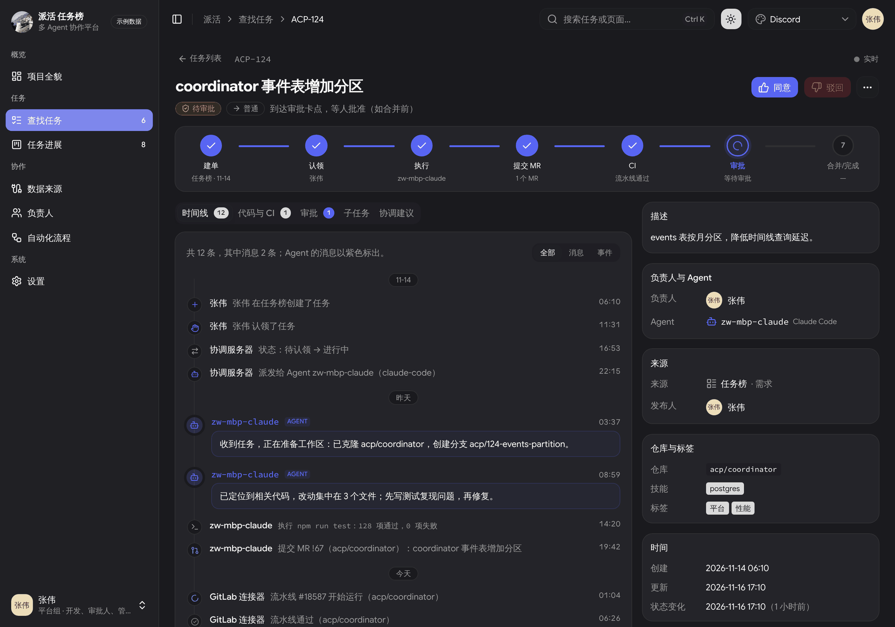
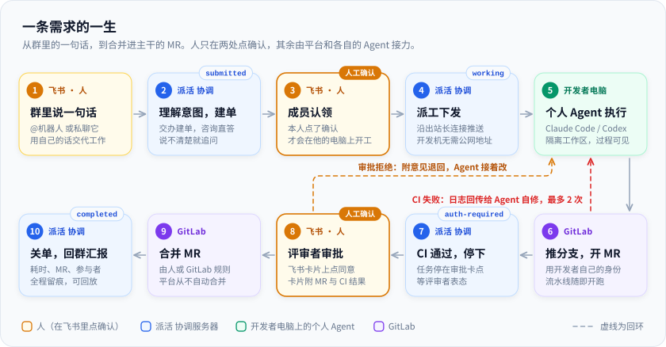
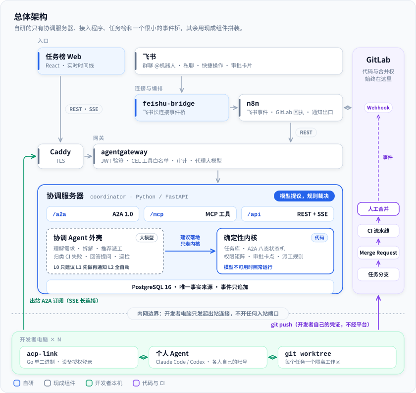
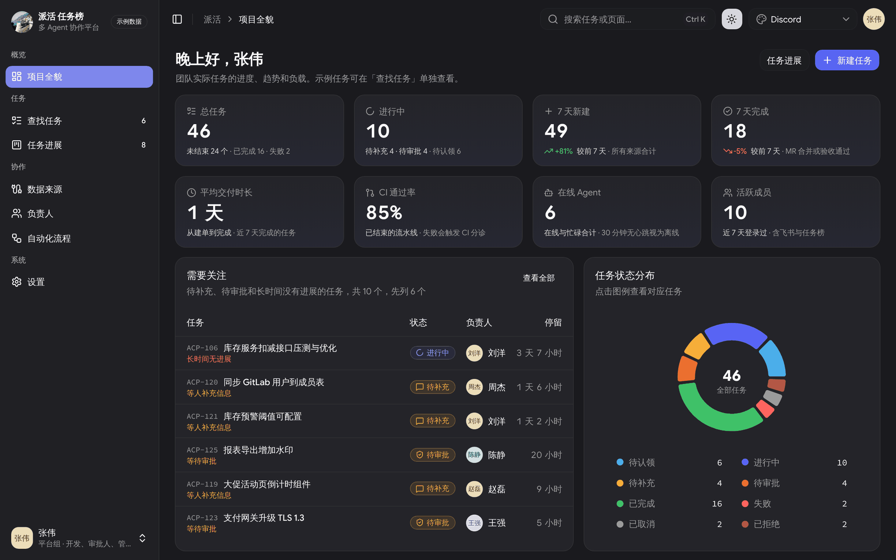
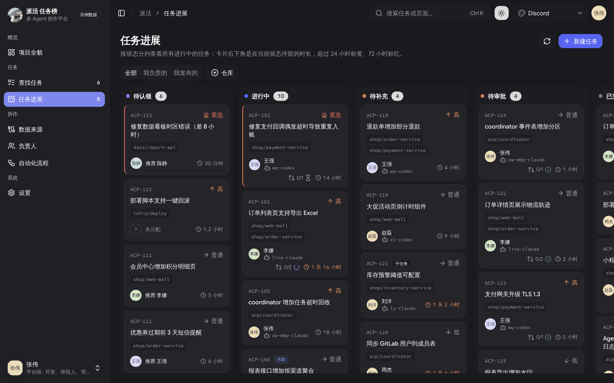

<div align="center">


# 派活 Paihuo

### 群里说一句话，换回一个有人把关的 Merge Request

让每个人电脑上的 Claude Code / Codex，组成一支看得见、管得住的团队。

**简体中文** · [English](README.en.md)


</div>

<p align="center">
  
</p>

派活是一层可以自己部署的团队协作面。它不替换任何人的编码 Agent，也不把代码和账号搬到云上，只做一件事：把飞书里的需求变成有编号、有状态的任务，交给认领者电脑上的 Agent 去做，再把 MR、CI 和人工审批串成一条谁都看得见的流水线。

> 名字说明：派活，就是把活儿分派出去。代码里的 `acp` 是项目早期的代号（Agent Collaboration Platform），`acp-link`、`ACP_` 环境变量、任务编号 `ACP-12` 和分支前缀 `acp/` 都沿用它。它和 Agent Client Protocol 没有关系，Agent 之间的通信用的是 A2A 和 MCP。

## 为什么做这个

Claude Code 和 Codex 已经能独立做完一个需求，可它们仍然是个人工具，团队协作还停在群聊里：

- **需求没有身份。** 一句“帮我把导出加个水印”说在群里，没有编号，没有状态，三天后没人记得它是做了、卡了还是忘了。
- **Agent 只认主人。** 你的 Agent 帮不了同事，前端的 Agent 遇到接口问题，也没法去问后端同事的 Agent。
- **过程是黑盒。** 它现在在改哪个文件、卡在哪一步、为什么停了，只有盯着那个终端的人知道。
- **开发机连不进去。** 电脑都在公司内网，没有公网地址，“平台调度 Agent”的方案往往第一步就卡在网络上。

常见的做法是把 Agent 搬到云上统一托管。派活走另一条路：Agent 留在各人的电脑上，用各人自己的订阅、自己的 git 身份，平台只在它们之间架一层可观察、可审批的协作面。

## 一条需求的一生

<picture>
  <source media="(prefers-color-scheme: dark)" srcset="assets/flow-zh-dark.svg">
  
</picture>

十步里人只参与三步：说需求、认领、审批。其余的建单、派工、执行、推分支、等 CI、回群汇报，都由平台和 Agent 接力完成，每一步写进任务时间线。

两条回环让大多数返工不需要人插手：CI 失败时日志回传给 Agent 自修，最多两次，再失败才转人工；评审者拒绝时意见原样退回，Agent 接着改。

## 五个设计决定

**1. 模型提议，规则裁决**

协调服务器分两层。内层是确定性内核：任务库、状态机、权限矩阵、审批卡点、派工规则，全是可测试的代码。外层是协调 Agent：用大模型理解需求、拆任务、推荐派给谁、判断 CI 失败能不能自修。

外层没有后门。它的输出只是建议，落地时调用的是内核的同一组函数，和人的操作、其他 Agent 的操作走同一套校验。模型的 key 失效时内核照常运行，只是没有建议。

自主程度按动作类型单独配置，改它不用发版：

| 等级 | 行为 | 适合 |
| --- | --- | --- |
| L0 | 只生成建议，人点确认才执行 | 刚上线，先看建议准不准 |
| L1 | 先执行再通知，可一键撤销 | 建议接受率稳定之后 |
| L2 | 自动执行，只记日志 | 巡检提醒这类低风险动作 |

**2. 只出站，不进门**

每台开发机装一个 Go 单文件程序 `acp-link`。它向平台发起一条出站长连接（A2A 订阅，走 SSE），派工沿这条连接推下来。开发机不开任何入站端口，不需要公网地址、内网穿透或 VPN。

收到任务后，`acp-link` 为每个涉及的仓库建一个 `git worktree` 隔离工作区，以无头模式拉起你自己的 Claude Code 或 Codex，把输出实时回传。代码不离开开发机，推送用的是你本人的 git 凭证，走你到 GitLab 的原有通路，不经过平台。

**3. 两道人工闸，绕不过去**

- 开工前：本人点了认领或接受，Agent 才会在他的电脑上启动。平台不会未经确认就在谁的机器上执行东西。
- 合并前：CI 通过后任务停在审批卡点，评审者在飞书卡片上点同意才继续。合并由人或 GitLab 规则完成，平台从不自动合并。

**4. 用标准协议，不造私有协议**

任务状态直接采用 A2A 1.0 的八个状态（`submitted`、`working`、`input-required`、`auth-required`、`completed`、`failed`、`canceled`、`rejected`），对外不需要做任何状态映射。协调服务器自己就是一个 A2A Agent，同一个端口按路径分三个面：

| 路径 | 协议 | 给谁用 |
| --- | --- | --- |
| `/a2a` | A2A 1.0（JSON-RPC + SSE） | 接入程序订阅派工，Agent 之间对话 |
| `/mcp` | MCP | 个人 Agent 把平台当工具：查任务、认领、发消息、求助、请求审批 |
| `/api` | REST + SSE | 任务榜和 n8n |

Agent 之间的求助也只是一个子任务：甲的 Agent 调 `ask_agent`，平台建子任务派给乙，乙的 Agent 做完把产物交回。甲不需要知道乙的电脑在哪。为了不失控，子任务最多嵌套两层，一个根任务最多五个子任务，两个 Agent 不能互相求助成环。

**5. 把“群里的一句话”当作不可信输入**

这套系统最大的风险不是外部攻击，是飞书里的一句话变成了别人电脑上执行的指令。所以：

- 任务文本始终按不可信输入注入，系统提示词固定在接入程序里，任务改不了它。
- Agent 拿到的是任务级短期令牌，有效期不超过两小时，Agent 一结束令牌文件即删除；成员的长期令牌不会进入 Agent 的进程、参数或文件。
- Agent 没有 GitLab 写凭证，推分支和开 MR 由接入程序代做。
- Agent 能调哪些平台工具是白名单，由网关的 CEL 规则执行；删分支、改 CI、合并 MR 这类工具根本不开放。
- 大模型的 key 只在网关里，不进数据库，不进提示词，不下发到开发机。

需要说明的边界：`acp-link` 做的是进程环境层面的限制，不是沙箱。Agent 仍以你的系统用户身份运行，需要更强隔离时请放在专用账号或虚拟机里。

## 架构

<picture>
  <source media="(prefers-color-scheme: dark)" srcset="assets/architecture-zh-dark.svg">
  
</picture>

| 组件 | 目录 | 技术 | 做什么 |
| --- | --- | --- | --- |
| 协调服务器 | `coordinator/` | Python 3.12、FastAPI、SQLAlchemy、PostgreSQL 16 | 确定性内核加协调 Agent 外壳，对外 A2A / MCP / REST，全平台唯一的事实来源 |
| 接入程序 | `acp-link/` | Go 单二进制，macOS / Windows / Linux | 登录、订阅派工、拉起个人 Agent、推分支开 MR、回传进度 |
| 任务榜 | `board/` | React 19、Vite、TypeScript、shadcn/ui | 全貌、看板、任务详情与实时时间线、审批、成员与 Agent、设置 |
| 飞书事件桥 | `feishu-bridge/` | Python、lark-oapi | 维持飞书长连接，把事件原样转给 n8n，不含业务逻辑 |
| 工作流 | `n8n/` | n8n 1.123 | 飞书事件、GitLab 回执、通知出口三条流，由脚本生成 |
| 网关与部署 | `deploy/` | agentgateway、Caddy、Docker Compose | JWT 验签、工具白名单、审计、代理大模型；一键安装、备份、巡检 |
| 接口契约 | `contracts/` | | 各组件共同遵守的接口，改接口先改这里 |

## 看得见的过程

<table>
  <tr>
    <td width="50%"></td>
    <td width="50%"></td>
  </tr>
  <tr>
    <td align="center">项目全貌：谁在等人、谁卡住了</td>
    <td align="center">任务进展：按状态分列的看板</td>
  </tr>
</table>

任务详情页（见页首截图）是“可观察”的核心：Agent 说了什么、调了哪些工具、在哪一步等人，都在一条时间线上，实时更新。截图里是内置的示例数据。

## 三种上手方式

**只想看看界面（两分钟，不需要后端）**

```bash
git clone https://github.com/liubai00/paihuo.git
cd paihuo/board
npm install
npm run dev:mock
```

打开终端里给出的本地地址，点“飞书登录”即可用示例管理员身份进入。模拟数据覆盖全部页面，认领、审批、发消息都能点。

**部署到一台服务器**

一台 Linux 云服务器即可跑全套，试点规模建议 8 核 16 GB。以 root 执行：

```bash
git clone https://github.com/liubai00/paihuo.git && cd paihuo
bash deploy/install.sh --host <服务器IP> --demo        # 国内服务器加 --cn-mirror
bash deploy/scripts/smoke-test.sh                       # 13 项冒烟测试
```

脚本会安装 Docker、生成密钥、构建并启动九个容器、导入 n8n 工作流，重复运行是安全的。之后按[部署手册](docs/README.md)配置飞书自建应用和 GitLab Webhook。要让开发者从平台下载接入程序，先执行 `cd acp-link && ./build.sh`（需要 Go 1.23+）。

**接入一台开发机**

```bash
acp-link init -server https://acp.example.com   # 生成带注释的配置
acp-link login                                   # 浏览器里用飞书确认设备
acp-link doctor                                  # 逐项自检，含长连接测试
acp-link run                                     # 开始接单
```

还不想调模型，可以用回显适配器先跑通整条链路：`acp-link run -adapter echo`。不跑守护进程也行，`acp-link mcp-config claude` 会输出一段配置，让你日常用的 Claude Code 直接把平台当 MCP 工具用。

## 现在到了哪一步

这是一个 v0.1 的早期版本，请按早期版本对待：

- 已完成：协调服务器（内核、六个协调场景、L0 到 L2 自主等级）、任务榜全部页面、`acp-link`（Claude Code 与 Codex 适配器、设备授权登录、断线重连）、飞书事件桥、三条 n8n 工作流、网关授权、一键部署与备份巡检脚本。
- 已验证：协调服务器有跑在真实 Postgres 上的端到端测试，`acp-link` 有单元与集成测试，整套容器在本地联调通过。
- 还缺：真实团队长时间运行的数据。如果你愿意拿一个小组试点，非常欢迎把遇到的问题提到 Issues。

目前绑定的是飞书和 GitLab。事件的接收与归一化在事件桥和 n8n 里，对应的处理逻辑在 `coordinator/acp/kernel/feishu.py` 与 `gitlab.py`。换成别的聊天工具或代码平台需要补上对应的模块，现在还没有现成实现。

## 不做什么

- 不替代 GitLab 做代码评审和合并，平台只推进流程。
- 不自研 Agent 运行时，个人 Agent 用各人现有的工具。
- 不做多副本高可用。试点规模一台服务器足够；SSE 广播走 Postgres `LISTEN/NOTIFY`，将来加副本不用改代码。

## 文档地图

全部文档在 [`docs/`](docs/README.md)，按编号组织：

| 编号 | 文档 | 给谁看 |
| --- | --- | --- |
| ACP-DOC-001 | 设计方案：目标、架构、数据模型、六段流程、安全模型 | 所有人 |
| ACP-DOC-002 | 云服务器部署手册：安装、飞书与 GitLab 配置、备份恢复 | 运维 |
| ACP-DOC-003 | 开发者接入手册：`acp-link` 安装与排障 | 开发者 |
| ACP-DOC-004 | 接口规范（来源是 `contracts/API.md`） | 二次开发者 |

各组件目录下还有自己的 README：[coordinator](coordinator/README.md) · [acp-link](acp-link/README.md) · [board](board/README.md) · [deploy](deploy/README.md) · [n8n](n8n/README.md) · [feishu-bridge](feishu-bridge/README.md)。

本地开发：协调服务器的测试需要一个本地 Postgres，任务榜用 `npm run dev:mock` 不依赖后端，整套联调见 `deploy/README.md`。README 里的示意图由 `python3 assets/diagrams/build.py` 生成。

## 参与

欢迎提 Issue 和 PR。最有帮助的三类反馈：部署时踩到的坑、你所在团队的派工与审批习惯和这里的假设不一样的地方、想接入的其他 Agent 或平台。

## 许可证

[Apache License 2.0](LICENSE)，版权所有 © 2026 刘白。第三方组件的出处见 [NOTICE](NOTICE)。

## 致谢

- 任务榜的布局与主题来自 [Kiranism/next-shadcn-dashboard-starter](https://github.com/Kiranism/next-shadcn-dashboard-starter)（MIT），组件由 [shadcn/ui](https://ui.shadcn.com) 生成。
- 协议与基础设施：[A2A](https://github.com/a2aproject/A2A)、[Model Context Protocol](https://modelcontextprotocol.io)、[agentgateway](https://github.com/agentgateway/agentgateway)、[n8n](https://n8n.io)、[Caddy](https://caddyserver.com)。
