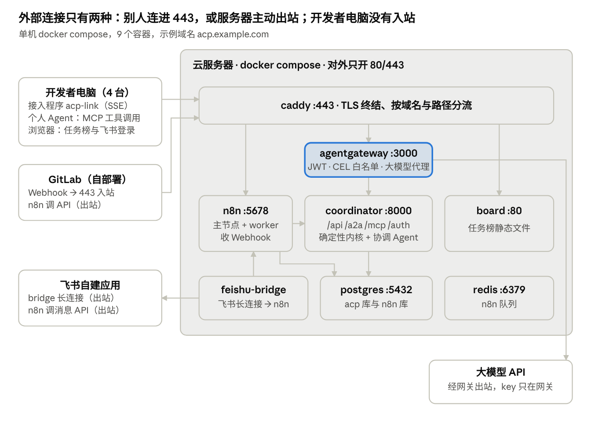

<!--
文档编号: ACP-DOC-002
版本: v1.2
日期: 2026-11-09
状态: 可执行，与 deploy/ 目录一致
配套: ACP-DOC-001 v2.1 设计方案，ACP-DOC-003 v1.0 开发者接入手册，ACP-DOC-006 v1.0 交接文档
在线可编辑版: https://claude.ai/artifact/JzAmGw3x3PNzqE1vPoJUjA
本文件为留存版，由在线版导出；修改请先改在线版，再导出覆盖本文件并升版本号。
-->

# ACP 云服务器部署手册

日期 2026-11-09 · 作者 Alex Morgan

文档编号 ACP-DOC-002 · 版本 v1.2 · 配套设计方案 ACP-DOC-001 v2.1 · 留存于项目仓库 docs/ 目录，变更记录见文末

## 1. 目标与范围

按本手册做完，一台云服务器上就跑起全部服务端组件（网关、协调服务器、队列模式的 n8n、飞书事件桥、任务榜、数据库），开发者电脑装上接入程序即可接入。安装由仓库里的 `deploy/install.sh` 一条命令完成，重复执行安全；本手册讲清楚它做了什么、装完怎么验证、飞书和 GitLab 怎么配、日常怎么运维。

**覆盖**：部署包上传与一键安装；只有 IP 时的 HTTP 运行方式和换成域名后的 HTTPS 方式；飞书自建应用与 GitLab 两侧的配置；公司内网放行；备份、恢复、升级、迁移到新服务器；日常运维与故障排查。

**不覆盖**：开发者电脑上接入程序与个人 Agent 的配置（ACP-DOC-003）；Kubernetes 扩容部署。

**约定**：示例服务器 `<服务器IP>`；命令在服务器上以 root 执行，代码与配置都在 `/opt/acp`，`docker compose` 一律在 `/opt/acp/deploy` 目录下执行；尖括号 `<...>` 表示要替换的值。

## 2. 部署总览

一台云服务器上的 docker compose，9 个常驻容器。Caddy 是唯一对外的入口：只有 IP 时用 HTTP，平台在 80 端口、n8n 在 5678 端口；换成域名后 Caddy 自动申请证书，平台和 n8n 各用一个域名走 443。A2A、MCP、REST 先过 agentgateway 验签和授权再到协调服务器；登录、JWKS、健康检查、浏览器 SSE 和 GitLab 直连 Webhook 直达协调服务器。开发者电脑不需要任何入站端口。



*图：部署拓扑 · 9 个容器，4 个外部方*

进服务器的只有浏览器、开发者电脑的接入程序和 GitLab Webhook；飞书事件、飞书与 GitLab 的接口调用、大模型调用都由服务器主动出站。

**容器清单**

| 容器 | 镜像 | 容器内端口 | 作用 |
| --- | --- | --- | --- |
| caddy | caddy:2-alpine | 80、443、5678 对外 | 入口：TLS、按路径分流、接入程序下载目录 `/downloads/` |
| agentgateway | cr.agentgateway.dev/agentgateway:v1.7.0 | 3000、3001 内部 | 3000：JWT 验签、MCP 工具白名单、A2A；3001：代理大模型并持有 key |
| coordinator | 仓库 coordinator/ 构建 | 8000 内部 | 确定性内核与协调 Agent：REST、A2A、MCP、登录、定时任务、通知 outbox |
| feishu-bridge | 仓库 feishu-bridge/ 构建 | 无 | 飞书长连接，事件原样转给 n8n |
| n8n | n8nio/n8n:1.123.1 | 5678 内部 | 界面与 Webhook 接收；三条工作流：飞书事件、GitLab 回执、通知出口 |
| n8n-worker | 同上 | 无 | 队列模式下执行工作流 |
| redis | redis:7-alpine | 6379 内部 | n8n 队列 |
| board | 仓库 board/ 构建 | 80 内部 | 任务榜静态文件（React + shadcn/ui） |
| postgres | postgres:16-alpine | 5432 内部 | acp 与 n8n 两个库 |

**对外地址（只有 IP 时）**

| 地址 | 到哪里 | 用途 |
| --- | --- | --- |
| `http://<IP>/` | board | 任务榜 |
| `http://<IP>/api/*`、`/a2a`、`/mcp` | agentgateway → coordinator | 三个接口面，必须带 JWT |
| `http://<IP>/auth/*`、`/.well-known/*`、`/healthz`、`/api/ping/stream`、`/api/tasks/<id>/stream`、`/api/hooks/*` | coordinator 直达 | 登录、公钥、健康检查、SSE、直连 Webhook |
| `http://<IP>/downloads/` | Caddy 静态目录 | 接入程序安装包 |
| `http://<IP>:5678/` | n8n | n8n 界面；GitLab Webhook 地址 `http://<IP>:5678/webhook/gitlab` |

**事件与通知怎么流动**

- 飞书 → 平台：feishu-bridge 长连接收事件 → n8n「ACP · 飞书事件」校验并归一化 → 协调服务器。n8n 不可用时可把 `BRIDGE_FORWARD_URL` 改为直连协调服务器。
- GitLab → 平台：项目 Webhook → n8n「ACP · GitLab 回执」→ 协调服务器；也可以直接配到 `http://<IP>/api/hooks/gitlab`。
- 平台 → 飞书 / GitLab：协调服务器把要发的卡片和 MR 评论写进 outbox，后台投递给 n8n「ACP · 通知出口」，由它调飞书和 GitLab 接口；失败自动重试，飞书或 GitLab 未配置时直接跳过。
- 开发者电脑 → 平台：接入程序用一条 SSE 长连接订阅派工，个人 Agent 的 MCP 调用走 `/mcp`。
- 协调 Agent → 大模型：coordinator 调 agentgateway 的 3001 端口，网关注入 key 并转给提供商。

## 3. 部署前准备

| 项 | 要求 | 备注 |
| --- | --- | --- |
| 云服务器 | 4 核 8 GB 起，推荐 8 核 16 GB；磁盘 60 GB 起；Ubuntu 22.04/24.04 或 Debian 12 | 其他 Linux 要自行装好 Docker 与 compose 插件 |
| 安全组 | 入站放行 TCP 22（限你的出口 IP）、80、5678；有域名后改为 80、443 | 5678 是 n8n 界面和 GitLab Webhook 入口 |
| 地域与备案 | 大陆地域对外提供域名访问需备案；只用 IP 不受影响 | 境外地域的服务器不需要备案 |
| 你电脑上的工具 | Git Bash（打包）、OpenSSH（上传） | 本机走 Clash 等代理时，给服务器 IP 加直连规则，否则 SSH 会被代理断开 |
| 飞书自建应用 | App ID、App Secret | 装完再配也可以，见第 9 节 |
| GitLab | 机器人账号和个人访问令牌、试点项目 | 装完再配也可以，见第 10 节 |
| 大模型 key | 可选 | 装完再配，见第 8 节 |

## 4. 一键安装

**4.1 在你电脑上打部署包**（项目根目录，Git Bash）

```bash
bash deploy/make-bundle.sh
```

产出 `.local/dist/acp-<时间>.tar.gz`：源码、部署文件、文档和接入程序二进制，不含任何密钥。

**4.2 上传并安装**（三种方式任选其一）

方式一，在你电脑的 PowerShell 里一条命令（会两次提示输入服务器密码）：

```powershell
powershell -ExecutionPolicy Bypass -File deploy\deploy-to-server.ps1 -Server <服务器IP> -Demo
```

方式二，手动 scp 与 ssh：

```bash
scp .local/dist/acp-<时间>.tar.gz root@<服务器IP>:/tmp/acp-bundle.tar.gz
ssh root@<服务器IP> "mkdir -p /opt/acp && tar xzf /tmp/acp-bundle.tar.gz -C /opt/acp && bash /opt/acp/deploy/install.sh --host <服务器IP> --demo"
```

方式三，本机 SSH 连不上时：用云控制台的网页终端（腾讯云 OrcaTerm 支持上传文件）把部署包传到 `/tmp`，再在网页终端里执行方式二引号里的那条命令。

`--demo` 会写入一批标为“示例”的任务、成员和 Agent，方便验收任务榜界面；确认后用 `docker compose exec coordinator acp-admin purge-demo` 一键删除。

**4.3 install.sh 做了什么**

1. 没有 Docker 就用 get.docker.com 安装（`--cn-mirror` 走国内镜像）。
2. 第一次运行时从 `.env.example` 生成 `deploy/.env`，所有密钥随机生成；再次运行只更新地址相关的几项，其余保留。
3. 生成 JWT 签名私钥 `deploy/secrets/jwt_private.pem`，把引导管理员密码写到 `deploy/secrets/admin-password.txt`。
4. 按 `.env` 生成网关配置 `deploy/agentgateway/config.yaml`。
5. 构建三个镜像（coordinator、feishu-bridge、board），启动数据库与队列，导入并激活 n8n 工作流，启动全部服务；协调服务器启动时自动迁移数据库。
6. 写入 `/etc/cron.d/acp`：每天 02:30 备份、每 5 分钟健康巡检。

| 参数 | 作用 |
| --- | --- |
| `--host <IP>` | 只有 IP 时使用，平台 `http://<IP>`，n8n `http://<IP>:5678` |
| `--domain <域名> --n8n-domain <域名> --email <邮箱>` | 有域名时使用，自动 HTTPS |
| `--demo` | 写入示例数据 |
| `--cn-mirror` | Docker、PyPI、npm 用国内镜像（大陆服务器） |
| `--no-docker-install` | 不自动安装 Docker |

## 5. 目录与配置

```
/opt/acp/
├── coordinator/  feishu-bridge/  board/  n8n/   源码，镜像在服务器上构建
├── acp-link/dist/                            接入程序二进制，经 /downloads/ 提供下载
├── docs/  contracts/                         文档与接口契约
└── deploy/
    ├── compose.yaml  caddy/  postgres/  scripts/  install.sh
    ├── .env                     全部配置（600）
    ├── secrets/                 jwt_private.pem、admin-password.txt、ops_webhook（700）
    └── agentgateway/config.yaml 由模板生成
数据在 Docker 数据卷：acp_pg_data、acp_n8n_data、acp_caddy_data；备份在 /var/backups/acp
```

**`.env` 里你会改的项**

| 变量 | 含义 |
| --- | --- |
| `ACP_PUBLIC_URL`、`N8N_PUBLIC_URL` | 对外地址，由 `--host` 或 `--domain` 设置 |
| `ACP_ADMIN_USERNAME`、`ACP_ADMIN_PASSWORD` | 引导管理员；飞书登录配好后可把密码置空关闭 |
| `FEISHU_APP_ID`、`FEISHU_APP_SECRET`、`FEISHU_CHAT_IDS`、`FEISHU_INTAKE_MODE`、`BRIDGE_EXTRA_EVENTS` | 飞书，见第 9 节 |
| `GITLAB_URL`、`GITLAB_BOT_TOKEN`、`GITLAB_WEBHOOK_TOKEN` | GitLab，见第 10 节；Webhook 密钥已自动生成 |
| `ACP_NOTIFY_MODE` | `n8n`（默认）、`direct`（协调服务器直接调飞书/GitLab）、`log`（只记录） |
| `N8N_API_KEY` | n8n 里创建的 API Key，任务榜“自动化流程”页用 |
| `ACP_LLM_ENABLED`、`LLM_PROVIDER`、`ACP_LLM_MODEL`、`LLM_API_KEY` | 协调 Agent，见第 8 节 |

改完 `.env`：飞书、GitLab、通知类的变量执行 `cd /opt/acp/deploy && docker compose up -d` 即可生效；地址和大模型类的变量改完重新执行 `bash /opt/acp/deploy/install.sh`（会重新生成网关配置）。

## 6. 装完之后的检查

**6.1 冒烟测试**（服务器上）

```bash
bash /opt/acp/deploy/scripts/smoke-test.sh
```

13 项检查全部“通过”即服务端正常：健康检查、公钥、Agent Card、网关拦截无令牌请求、任务榜、管理员登录、带令牌访问 API、MCP 工具列表、SSE、飞书与 GitLab 两条事件链路、GitLab 直连通路、下载目录。它不产生任何任务数据，可以随时重跑。

**6.2 登录任务榜**

浏览器打开 `http://<服务器IP>`，用“本地管理员”登录：用户名 `admin`，密码在服务器的 `/opt/acp/deploy/secrets/admin-password.txt`。飞书登录配好后，第一个用飞书登录的人自动成为管理员，其他人的角色在任务榜“负责人”页或用命令调整：

```bash
cd /opt/acp/deploy
docker compose exec coordinator acp-admin list-members
docker compose exec coordinator acp-admin grant-role --member <名字或ID> --role reviewer
```

**6.3 n8n**

打开 `http://<服务器IP>:5678`，创建 owner 账号并开启两步验证。三条工作流（ACP · 飞书事件、ACP · GitLab 回执、ACP · 通知出口）安装时已导入并激活，不需要配置任何 n8n 凭证，它们从环境变量读取密钥。想在任务榜“自动化流程”页看到执行记录：n8n 里 Settings → n8n API 创建一个 API Key，填进 `.env` 的 `N8N_API_KEY`，执行 `docker compose up -d`。

工作流被改乱或误删时，以仓库为准重新导入：`bash /opt/acp/deploy/scripts/n8n-provision.sh`。

**6.4 安全组**

确认云厂商安全组只放行 22（限来源）、80、5678；其余端口都在 Docker 内部网络，没有发布到宿主机。

## 7. 换成域名与 HTTPS

只用 IP 时全程是 HTTP，登录令牌明文传输，只适合试用。正式使用前换成域名：

1. 两条 A 记录指向服务器：`acp.<你的域名>`、`n8n.acp.<你的域名>`；安全组放行 80、443。
2. 服务器上执行 `bash /opt/acp/deploy/install.sh --domain acp.<域名> --n8n-domain n8n.acp.<域名> --email <邮箱>`，Caddy 自动申请证书。
3. 同步修改三处地址：飞书重定向 URL（第 9.4 节）、GitLab Webhook（第 10.2 节）、开发者电脑 acp-link 配置里的 `server`。
4. 所有人重新登录一次（令牌的签发方随地址变了）。

## 8. 启用协调 Agent（大模型）

不配大模型也能跑：规则派工、关键词建单整理、CI 失败归类、问答和巡检都有规则兜底。配上模型后六个场景会给出更完整的建议。

```dotenv
ACP_LLM_ENABLED=true
LLM_PROVIDER=anthropic        # 或 openAI
ACP_LLM_MODEL=<模型名>
LLM_API_KEY=<你的 key>      # 只会进 agentgateway 容器
```

改完执行 `bash /opt/acp/deploy/install.sh`。各场景的自主等级默认 L0（只建议），在任务榜“设置”页逐项调整。验证：新建一条描述较长的任务，详情页“协调建议”里出现引擎为 llm 的建议。

## 9. 飞书自建应用配置

在飞书开放平台 open.feishu.cn 的开发者后台操作。顺序很重要：先把凭证填进服务器让事件桥连上，控制台才允许保存“长连接”订阅方式。

**9.1 填凭证、连上长连接**

凭证与基础信息 → 复制 App ID（cli_ 开头）和 App Secret，填进服务器 `/opt/acp/deploy/.env`：

```dotenv
FEISHU_APP_ID=cli_xxxxxxxx
FEISHU_APP_SECRET=xxxxxxxx
```

```bash
cd /opt/acp/deploy && docker compose up -d && docker compose logs --tail=20 feishu-bridge
```

日志里出现 `connected to wss://` 且没有报错即连上。

**9.2 开启机器人**：添加应用能力 → 机器人 → 启用，名字建议“ACP 协调”。

**9.3 权限**（权限管理 → 开通）

| 权限 | 标识 | 用途 |
| --- | --- | --- |
| 获取用户基本信息 | contact:user.base:readonly | 飞书登录拿姓名、头像 |
| 获取与发送单聊、群组消息 | im:message | 发任务卡片、回复、读取被“转为任务”的消息 |
| 以应用的身份发消息 | im:message:send_as_bot | 机器人主动通知 |
| 接收群聊中 @机器人 消息 | im:message.group_at_msg:readonly | @机器人 建单 |
| 读取用户发给机器人的单聊消息 | im:message.p2p_msg:readonly | 私聊问进度 |
| 获取群组信息 | im:chat:readonly | 识别群 |
| 获取群组中所有消息（可选） | im:message.group_msg | 全群监听模式，敏感权限，需企业管理员审批 |

标识以控制台显示为准；后面添加事件时控制台提示缺什么权限就补什么。

**9.4 飞书登录回调**：安全设置 → 重定向 URL → 添加 `http://<服务器IP>/auth/feishu/callback`（换域名后改成 `https://acp.<域名>/auth/feishu/callback`）。如果控制台不接受 http 地址，先做第 7 节换域名。

**9.5 事件与回调**（确认 9.1 已连上）

1. 事件与回调 → 事件配置 → 订阅方式选“使用长连接接收事件”→ 保存。
2. 添加事件：“接收消息 v2.0”（im.message.receive_v1）。
3. 回调配置 → 同样选长连接 → 添加“卡片回传交互”（card.action.trigger）。

长连接不需要填请求地址、Verification Token、Encrypt Key，飞书也不需要访问你的服务器。

**9.6 消息快捷操作（“转为任务”）**：应用功能 → 消息快捷操作 → 新建，名称“ACP 建单”，可用范围选群聊。把控制台显示的该快捷操作的事件类型填到 `.env` 的 `BRIDGE_EXTRA_EVENTS`（事件类型里含 `shortcut` 即可被自动识别），`FEISHU_INTAKE_MODE` 保留 `shortcut`，执行 `docker compose up -d`。

**9.7 全群监听（可选）**：申请到 im:message.group_msg 并发布后，`FEISHU_INTAKE_MODE` 加上 `all`。协调服务器对疑似需求只发“要建单吗？”确认卡，不自动建单；不开也不影响 @机器人 和快捷操作。

**9.8 发布版本**：版本管理与发布 → 创建版本 → 可用范围选试点成员 → 申请发布 → 企业管理员审核。权限和事件的任何修改都要重新发布才生效。

**9.9 机器人入群与验证**

1. 试点群 → 设置 → 群机器人 → 添加机器人 → 选这个应用。
2. 群里发“@ACP 协调 帮助”，机器人回复用法。
3. 发“@ACP 协调 @某人 登录页支持深色模式”，任务榜出现新任务，群里收到任务卡片，被 @ 的人私聊收到派工卡片。
4. 想只受理这个群：在任务榜“数据来源”页的飞书事件里找到 chat_id（oc_ 开头），填到“设置”页或 `.env` 的 `FEISHU_CHAT_IDS`。

**9.10 运维告警机器人（可选）**：在运维群添加“自定义机器人”，把 Webhook 地址写进 `/opt/acp/deploy/secrets/ops_webhook`（chmod 600），健康巡检失败时会发到这个群。

## 10. GitLab 配置

GitLab 在公司内网。Webhook 是 GitLab 主动访问云服务器，只要内网允许出站就通；反过来云服务器通常访问不到内网 GitLab，所以“在 MR 上写审批评论”是可选功能，访问不到就留空，其余流程不受影响。

**10.1 Webhook（必须）**

在服务器上取出密钥：`grep GITLAB_WEBHOOK_TOKEN /opt/acp/deploy/.env`。每个试点项目 Settings → Webhooks → Add new webhook：

| 字段 | 值 |
| --- | --- |
| URL | `http://<服务器IP>:5678/webhook/gitlab`（经 n8n，推荐）或 `http://<服务器IP>/api/hooks/gitlab`（直连） |
| Secret token | 上面取出的 `GITLAB_WEBHOOK_TOKEN` |
| Trigger | Push events（分支过滤填 `acp/*`）、Merge request events、Pipeline events |
| SSL verification | 只有 IP 时是 HTTP，不涉及；换域名后勾选 |

保存后点 Test → Push events，Recent events 显示 200 即通；任务榜“数据来源”页的 GitLab 事件里会多一条“已忽略”的记录（测试事件不是 acp/ 分支）。如果 Test 报超时，是内网出口拦了到服务器 5678（或 80）的访问，找 IT 放行。

**10.2 机器人账号与 MR 评论（可选）**

新建用户 `acp-bot`，加入试点项目（Developer），创建个人访问令牌（范围 api，有效期 1 年）。云服务器能访问到 GitLab 时填：

```dotenv
GITLAB_URL=https://gitlab.<公司域名>
GITLAB_BOT_TOKEN=glpat-xxxxxxxx
```

执行 `docker compose up -d`。审批通过后平台会在 MR 下写一条“ACP 审批通过”的评论。

**10.3 分支约定**：平台按分支名 `acp/<任务号>-<摘要>` 把推送、MR、流水线对到任务，接入程序会自动用这个名字建分支。可选地在项目 Push rules 里限制分支名格式。

**10.4 开发者推代码**：用开发者自己电脑上既有的 git 凭证，接入程序用 GitLab push options 自动开 MR，不需要任何 GitLab 令牌。

## 11. 公司内网放行

| 方向 | 源 | 目的 | 端口 | 用途 |
| --- | --- | --- | --- | --- |
| 出站 | 开发者电脑 | `<服务器IP>` | TCP 80（换域名后 443） | 任务榜、接入程序订阅（SSE 长连接）、MCP |
| 出站 | GitLab 服务器 | `<服务器IP>` | TCP 5678（或 80） | Webhook |
| 入站 | 无 | 开发者电脑 | 无 | 平台从不主动连开发者电脑 |

要求：到服务器的连接空闲超时不低于 90 秒、不缓冲响应体；内网强制代理时把代理地址告诉开发者（接入程序读 `HTTPS_PROXY` 或配置里的 `proxy`）。在一台开发者电脑上测试（Windows 用 curl.exe）：

```bash
curl -sS http://<服务器IP>/healthz
curl -N -sS --max-time 95 http://<服务器IP>/api/ping/stream
```

第二条应每 30 秒打印一行 `event: ping`，到 95 秒自行结束；60 秒左右就断，是中间设备的空闲超时。

## 12. 备份与恢复

每天 02:30 自动备份到 `/var/backups/acp`，保留 30 天：

| 文件 | 内容 |
| --- | --- |
| `pg-<日期>.sql.gz` | 两个数据库（任务、成员、事件、n8n 工作流与执行记录） |
| `n8n-data-<日期>.tgz` | n8n 数据卷 |
| `config-<日期>.tgz` | `.env`、`secrets/`、网关配置 |

手动备份：`bash /opt/acp/deploy/scripts/backup.sh`。备份在同一台机器上只防误操作，至少每周把 `/var/backups/acp` 拷到别处（对象存储或你的电脑）；`N8N_ENCRYPTION_KEY` 与 `jwt_private.pem` 另存一份到密码管理器。

恢复（会停服并覆盖当前数据，需要输入 yes 确认）：

```bash
bash /opt/acp/deploy/scripts/restore.sh <日期，如 2026-11-10>
```

## 13. 升级、回滚与迁移

**升级**：你电脑上重新 `bash deploy/make-bundle.sh`，把新包传到服务器后：

```bash
tar xzf /tmp/acp-bundle.tar.gz -C /opt/acp      # 只覆盖代码，.env 与 secrets 不在包里
bash /opt/acp/deploy/scripts/upgrade.sh          # 先备份，再重建镜像、重启，数据库自动迁移
bash /opt/acp/deploy/scripts/smoke-test.sh
```

**回滚**：解压上一版部署包覆盖后再执行 `upgrade.sh`；如果新版改过数据库结构，用 `restore.sh` 恢复升级前的备份。

**迁移到新服务器**

1. 旧服务器：`bash /opt/acp/deploy/scripts/backup.sh`，把 `/var/backups/acp` 里当天的三个文件和部署包拷到新服务器。
2. 新服务器：解压部署包到 `/opt/acp`，再把 `config-<日期>.tgz` 解到 `/opt/acp/deploy`（还原 `.env` 与密钥）。
3. 新服务器：`bash /opt/acp/deploy/install.sh --host <新IP>`（或 `--domain ...`），再 `bash /opt/acp/deploy/scripts/restore.sh <日期>`，最后跑冒烟测试。
4. 地址变了的话同步改飞书重定向 URL、GitLab Webhook、开发者 acp-link 的 `server`，所有人重新登录。

## 14. 日常运维

所有命令在 `/opt/acp/deploy` 下执行。

| 事项 | 命令 |
| --- | --- |
| 看状态 | `docker compose ps` |
| 看日志 | `docker compose logs -f --tail=200 <服务名>`（coordinator、agentgateway、n8n、feishu-bridge、caddy） |
| 重启单个服务 | `docker compose restart <服务名>` |
| 冒烟测试 | `bash scripts/smoke-test.sh` |
| 健康巡检 | `bash scripts/healthcheck.sh`（cron 每 5 分钟跑一次，日志 `/var/log/acp-health.log`） |
| 成员与角色 | `docker compose exec coordinator acp-admin list-members` / `grant-role` / `revoke-role` |
| 删示例数据 | `docker compose exec coordinator acp-admin purge-demo` |
| 重导 n8n 工作流 | `bash scripts/n8n-provision.sh` |
| 进数据库 | `docker compose exec postgres psql -U acp -d acp` |
| 接口文档 | 浏览器打开 `http://<服务器IP>/api/docs` |
| 磁盘 | `df -h /`、`docker system df`、`docker image prune -f` |

## 15. 故障排查

| 现象 | 先看 | 常见原因 |
| --- | --- | --- |
| 本机 scp/ssh 连服务器时立即断开 | 本机代理软件 | Clash 等 TUN 模式接管了 22 端口；给服务器 IP 加直连规则，或用云控制台网页终端 |
| 打不开任务榜 | `docker compose ps`、`logs caddy` | 安全组没放行 80；board 镜像构建失败 |
| `/healthz` 通但 API 全是 401 | `logs agentgateway` | 令牌过期；改过地址却没重跑 install.sh（网关的 issuer 与 `ACP_PUBLIC_URL` 不一致） |
| agentgateway 反复重启 | `logs agentgateway` | 协调服务器未就绪拿不到 JWKS（稍等自动恢复）；`AGW_SESSION_KEY` 不是 64 位十六进制 |
| Agent 看不到某个 MCP 工具 | `agentgateway/config.yaml` 的 rules | 网关按角色过滤：ask_agent 只对 Agent 任务令牌可见，claim_task 只对成员本人可见 |
| 飞书 @机器人 没反应 | `logs feishu-bridge`；n8n 执行记录；任务榜“数据来源” | 长连接没连上；事件或权限没发布；群不在 `FEISHU_CHAT_IDS`；没 @ 机器人 |
| 任务建了但群里没卡片 | 任务榜“数据来源”→通知出口；n8n「ACP · 通知出口」执行记录 | 飞书凭证未配（通知会被跳过）；缺 im:message 权限；机器人不在群里 |
| 飞书登录报错 | `logs coordinator` | 重定向 URL 没登记或与 `ACP_PUBLIC_URL` 不一致；App Secret 错 |
| GitLab Webhook 测试失败 | GitLab Recent events；n8n 执行记录 | Secret 不一致；内网出口没放行 5678；安全组没放行 5678 |
| n8n 工作流不生效 | n8n 界面工作流列表 | 未激活；重跑 `scripts/n8n-provision.sh` |
| n8n 提示凭证解密失败 | `logs n8n` | `N8N_ENCRYPTION_KEY` 变了（恢复时没用原 key） |
| 接入程序反复重连 | 开发者电脑上 `acp-link doctor` | 内网代理切断空闲连接（第 11 节）；令牌过期 |
| 任务卡在进行中 | 详情页时间线；负责人的 Agent 是否在线 | 负责人没有在线 Agent（排队等待）；30 分钟无心跳会自动回收 |
| 容器起不来、构建失败 | `docker compose build` 输出 | 拉取镜像或依赖超时；大陆服务器加 `--cn-mirror` 重跑 install.sh |

## 16. 安全基线

- [ ] 服务器 root 密码已改成只有你知道的新密码
- [ ] SSH 改为密钥登录，关闭密码登录；22 端口在安全组里限来源 IP
- [ ] 安全组只放行 22、80、5678（或 80、443）
- [ ] `deploy/.env` 为 600、`deploy/secrets/` 为 700
- [ ] 飞书登录配好后，把 `ACP_ADMIN_PASSWORD` 置空关闭本地管理员登录（或换成强密码）
- [ ] n8n 已创建 owner 并开启两步验证
- [ ] 示例数据已用 `purge-demo` 删除
- [ ] 正式使用前已换域名和 HTTPS（第 7 节）
- [ ] GitLab 机器人账号不高于 Developer，令牌有到期日
- [ ] 大模型 key 只在 `LLM_API_KEY`（只进 agentgateway 容器）
- [ ] 备份在跑，并做过一次恢复演练；备份有异地副本

## 17. 部署验收清单

- [ ] `smoke-test.sh` 13 项全部通过
- [ ] 用引导管理员登录任务榜，项目全貌、查找任务、任务进展、数据来源、负责人、自动化流程、设置页都能打开
- [ ] n8n 三条工作流处于激活状态
- [ ] 飞书：@机器人 建单、群里收到卡片、点“认领”生效、飞书登录任务榜成功
- [ ] GitLab：Webhook 测试返回 200
- [ ] 一台开发者电脑：`acp-link doctor` 全部通过，任务榜“负责人 → Agent”里显示在线
- [ ] 端到端：飞书发一个小需求 → 认领 → 开发者电脑上的 Agent 自动执行 → 推分支开 MR → CI 通过 → 飞书审批 → 合并后任务自动完成
- [ ] 健康巡检与备份的 cron 已安装（`/etc/cron.d/acp`）
- [ ] 第 16 节全部打勾

## 变更记录

| 版本 | 日期 | 变更 |
| --- | --- | --- |
| v1.2 | 2026-11-09 | 按实际实现重写：一键安装脚本 install.sh 与部署包、服务器目录改为 /opt/acp/deploy、只有 IP 时的 HTTP 运行方式（平台 80、n8n 5678）与换域名步骤、n8n 工作流自动导入激活且不依赖凭证、冒烟测试脚本、迁移步骤、GitLab 在内网时 MR 评论为可选、通知在飞书/GitLab 未配置时自动跳过 |
| v1.1 | 2026-11-09 | 配合设计方案 v2.0 取消分阶段：agentgateway 首版即上，n8n 队列模式加 Redis 与 worker，大模型 key 只在网关 |
| v1.0 | 2026-11-09 | 首版：单机 docker compose 部署，17 节正文加部署拓扑图 |
